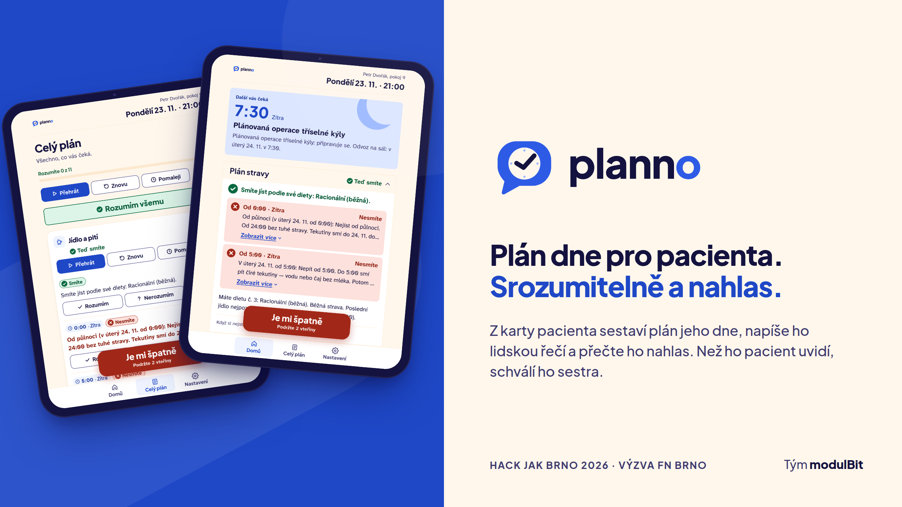

<picture>
  <source media="(prefers-color-scheme: dark)" srcset="assets/banner-dark.png">
  
</picture>

**planno**: denní plán pacienta. Náš projekt na hackathonu **Hack Jak Brno 2026**, výzva FN Brno (Chirurgická klinika).

---

## Problém

Pacient na chirurgii často neví, co ho ten den čeká: jestli půjde na sál nebo na CT, od kdy nesmí jíst, které léky dostane. Lékař to při vizitě nestihne vysvětlit a sestry odpovídají pořád na stejné otázky. Informace v nemocnici přitom jsou, jen roztroušené po kartě.

## Co stavíme

Aplikaci, která z karty pacienta sestaví **plán jeho dne**, napíše ho jednoduchou řečí a **přečte ho nahlas**.

1. **Karta:** načte JSON s daty pacienta (čtení ručně psaných listů z fotky je bonus)
2. **Plán:** pevná struktura v devíti oblastech: dieta, mobilita, operace, příprava k operaci, konzilia, odběry, CT/ultrazvuk, léky, výsledky
3. **Text:** věty v řeči pacienta, u každé jde ukázat, ze kterého údaje vychází
4. **Hlas:** česky, s možností pustit znovu a zpomalit
5. **Schválení:** sestra text nejdřív vidí, může ho opravit a teprve pak ho dostane pacient

Navíc: simulovaný čas (den jde přehrát krok po kroku), přepočet plánu při změně, tlačítka **Rozumím / Nerozumím** a **Je mi zle**.

## Hlavní pravidlo: nic se nedomýšlí

- Každá věta má oporu v datech. Žádný vymyšlený čas, dávka ani diagnóza.
- Chybí údaj? Aplikace řekne „ještě nevíme“ nebo „zeptejte se sestry“.
- **Lačnění je bezpečnostní údaj.** Když si aplikace není jistá, nikdy neřekne „můžete jíst“.
- Citlivé výsledky ukáže až po uvolnění lékařem.

## Tým

| Kdo | Na čem dělá |
| --- | --- |
| [@jonashubeny](https://github.com/jonashubeny) | Frontend: JavaScript, UI, tlačítka a veškerá grafika |
| [@smoliicek](https://github.com/smoliicek) | Backend: server, AI a veškerá logika |
| [@vlcak27](https://github.com/vlcak27) | Vibecoding a testování |

## Repozitáře

- [`frontend`](https://github.com/modulbit-hjb/frontend): hlavní repo aplikace
- [`design`](https://github.com/modulbit-hjb/design): logo, barvy, písmo, bannery
- [`.plan`](https://github.com/modulbit-hjb/.plan): zadání, prezentace, modeloví pacienti a naše poznámky

---

Všichni pacienti v podkladech jsou smyšlení. Mentor: MUDr. Vladimír Čan, zadavatel: Ing. Eva Hesková (FN Brno).

<picture>
  <source media="(prefers-color-scheme: dark)" srcset="assets/planno-mark-dark-128.png">
  
</picture>

